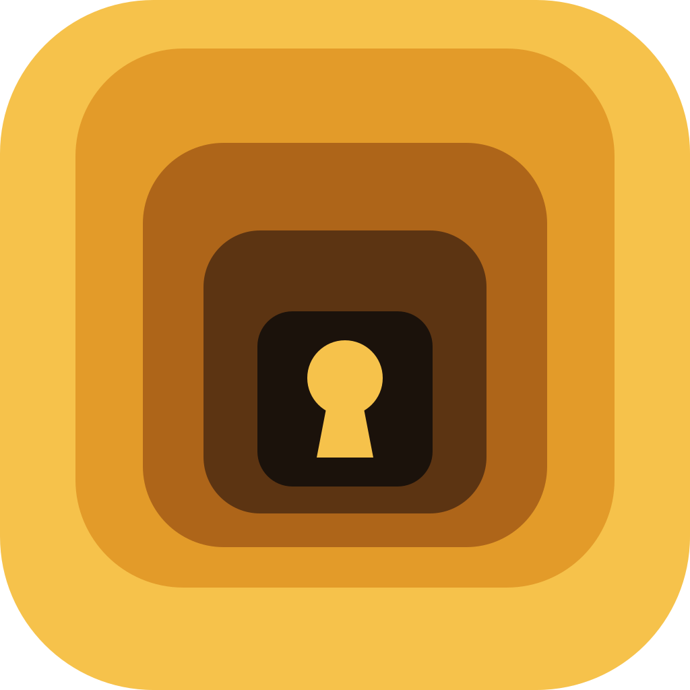

<p align="center"></p>

# Saltcellar

Saltcellar keeps your passwords, environment keys and backup codes in one encrypted file on your own Windows PC. One window, one file, no network.

It is for the secrets that should never leave the machine they are used on: the `DATABASE_URL` for a side project, an API token, the backup codes a site gave you once. The alternatives are a text file anyone can read, or a password manager that wants an account and a cloud to keep your vault in. Saltcellar is neither. There is no account, no sync and no server: the vault is a file on your disk, encrypted under a master password only you know. The cost is the cloud's own benefit: nothing syncs to your phone, and if the disk dies, only a backup you made brings the vault back.

It was called **lokey** until 0.4.0. An existing lokey vault is copied over on the first start; see [Upgrading from lokey](#upgrading-from-lokey).

[](https://github.com/akshit-bansal11/saltcellar/actions/workflows/ci.yml)
[](https://github.com/akshit-bansal11/saltcellar/releases/latest)
[](LICENSE)
[](https://saltcellar.akshitbansal.dev/docs)

## What it does

- **No network code, ever.** No account, no sync, no telemetry, no update check. The app's content security policy forbids every connection.
- **Encrypted at rest.** Entries are sealed with AES-256-GCM under a random data key, which is itself sealed under a key derived from your master password with Argon2id (64 MiB, 3 passes).
- **Projects and keys.** One project at a time as a sheet of keys and values; `DATABASE_URL` can exist once in `web` and once in `api`.
- **A password generator** (the dice button, or Ctrl+G), drawing from the operating system's random number generator.
- **Careful with the clipboard.** Copied values stay out of Win+V history and cloud clipboard, and are cleared after 30 seconds.
- **Hidden from screenshots and screen sharing**, and locked after 5 minutes idle and whenever it closes.
- **Verifiable builds.** Every release file has a SHA-256 checksum and a signed build attestation tying it to the commit and workflow that built it.

## Install

Saltcellar comes from the [latest release](https://github.com/akshit-bansal11/saltcellar/releases/latest), under **Assets**. The file is named for its release: `Saltcellar-0.4.0.exe` is 0.4.0. It is the whole install: one portable exe, no setup program, no administrator rights, nothing written outside your own user folder. Put it wherever you keep your tools; to remove Saltcellar, delete it.

Windows 10 or 11, 64-bit, with WebView2 (built into Windows 11, and into any Windows 10 kept up to date).

1. Download `Saltcellar-<version>.exe` and `SHA256SUMS.txt` from the same release.
2. Check the download, as below.
3. Run it. The builds are not code-signed yet, so SmartScreen asks first: choose **More info**, then **Run anyway**.

### Check the download

The checksum proves the file is the one the release published. In PowerShell, in the folder you downloaded to:

```powershell
(Get-FileHash .\Saltcellar-<version>.exe -Algorithm SHA256).Hash.ToLower()
Get-Content .\SHA256SUMS.txt
```

The two hashes must be identical. With Git Bash, WSL or Linux, `sha256sum -c SHA256SUMS.txt` does the comparison and prints `OK`.

The attestation proves the file was built by this repository's release workflow from a tagged commit. With the [GitHub CLI](https://cli.github.com):

```text
gh attestation verify Saltcellar-<version>.exe --repo akshit-bansal11/saltcellar
```

## Upgrading from lokey

lokey kept its vault in `%LOCALAPPDATA%\lokey`; Saltcellar keeps it in `%LOCALAPPDATA%\saltcellar`. On its first start, Saltcellar copies your vault across:

1. **Close lokey first**, every window of it.
2. Start Saltcellar. If `%LOCALAPPDATA%\lokey` holds a vault and `%LOCALAPPDATA%\saltcellar` does not, Saltcellar copies `vault.lokey`, `vault.lokey.bak` and `lockout.json` across, then asks for your master password as before. The status bar says the vault was copied, and `%LOCALAPPDATA%\saltcellar\migration.log` records it.
3. Once Saltcellar has opened your vault and you have checked your entries, delete `%LOCALAPPDATA%\lokey` and `lokey.exe` yourself. Saltcellar never does.

What the copy does and does not do:

- It **copies, never moves.** The lokey folder is only read: nothing in it is changed, moved or deleted, so lokey still opens it if anything goes wrong.
- It happens **once**. If `%LOCALAPPDATA%\saltcellar` already holds a vault, nothing is copied and both are left alone.
- It is **skipped** when `SALTCELLAR_DIR` or `LOKEY_DIR` is set: Saltcellar opens the folder you chose.
- If the copy fails, Saltcellar shows the reason instead of offering to create a new vault, writes it to `migration.log`, and tries again on the next start.
- The vault format is unchanged. Vault and backup files keep their `.lokey` names, and backups made by lokey restore in Saltcellar.

Changes you make in lokey after the copy stay in lokey's folder. Use one or the other.

## First use

The first run offers to create the vault. You choose one **master password**. It must be at least 15 characters, and Saltcellar refuses passwords that appear in public lists of leaked passwords. A few random words make a strong password that is easy to remember. Once it is entered, everything is open: reading, adding, editing, copying and deleting. Deleting asks you to confirm.

Then you choose what happens if you forget it:

- **A recovery key (recommended).** Saltcellar shows a 32-character key once, and asks you to type it back to prove you saved it. Write it on paper and keep it away from the PC. If you forget the master password, the recovery key opens the vault and you choose a new password; you then get a new recovery key and the used one stops working.
- **No recovery.** Only the master password opens the vault. Forget it and everything in it is gone, for you and for anyone else.

There are no password hints and no security questions. Either would become the easiest way into the vault, so Saltcellar offers neither. You can turn the recovery key on, replace it or remove it later in Settings.

## Use

The app shows one project at a time as a sheet with three columns: number, key and value. Values stay hidden until you show one, and only one is shown at a time.

- Type a name and value in the last row and press Enter to add a key.
- Show, copy, edit and delete are on each row. Copying clears the clipboard after 30 seconds, and a thin line in the status bar counts it down.
- **Generate a password** (the dice button, or Ctrl+G): pick a length from 8 to 128 and which characters to use (uppercase, lowercase, digits, symbols). Copy it, or choose **Use as new key** to put it in the last row's value, then name the key and press Enter.
- Everything works from the keyboard. Press **F1** (or `?`) for the full list: Ctrl+N adds a key, Ctrl+Shift+N makes a project, Ctrl+PgUp/PgDn switch projects, Ctrl+F searches, Ctrl+G opens the generator, Ctrl+, opens settings, Ctrl+L locks; in the rows, Up/Down/Home/End move, Enter shows, Ctrl+C copies, F2 edits, Del deletes.
- **Projects** keep the same key name apart. New keys go to `default` unless you pick another.
- **Names** use letters, digits and `_ - . /`, and match regardless of case.
- The app locks itself after 5 minutes without use, and whenever it is closed: the next start asks for the master password again.

### Backups

**Settings → Export backup…** asks for your master password again, then where to save. The backup is the vault file itself, still encrypted: it opens with the master password, or the recovery key, the vault had when you exported it. Keep one on a USB drive or another disk; the vault on your PC is a single file, and a dead disk takes it with it. A folder synced by OneDrive or a similar service uploads whatever you save there.

To move to a new PC, or after losing the disk, start Saltcellar with no vault and choose **Restore from a backup…**. Saltcellar never restores over an existing vault.

### Where the vault lives

`%LOCALAPPDATA%\saltcellar\vault.lokey`, with a small `lockout.json` beside it and `vault.lokey.bak`, the version before the last change. Set `SALTCELLAR_DIR` (or the older `LOKEY_DIR`) to keep them somewhere else. Local, not roaming: Windows never syncs the folder.

Two Saltcellar windows can be open at once: every change takes a lock on the file, reads it fresh, applies one change and writes it back whole, so the two never overwrite each other.

## How it works

- Your entries are encrypted with **AES-256-GCM** under a random 256-bit **data key**.
- The data key is stored at most twice, each copy encrypted: once under a key derived from your master password, and once under a key derived from the recovery key if you have one. Both derivations use **Argon2id** (64 MiB, 3 passes, 1 lane), which makes every guess against a stolen file slow and costly.
- Changing the master password, or making or removing a recovery key, replaces the data key. An old password or recovery key opens only copies of the file made before the change.
- Every header field an attacker could weaken (the salt, the cost settings) is bound into the encryption, so a changed file fails to open rather than opening weakened or wrong.
- Wrong passwords and recovery keys slow down (1 s, 2 s, 4 s … up to 30 s) and lock for 15 minutes after 10 in a row.
- Exporting a backup, changing the master password and making or removing a recovery key each ask for the master password again, even with the vault open.

What Saltcellar cannot protect you from, and how to report a problem, is in [SECURITY.md](SECURITY.md). **No independent security audit** has been done yet. The encryption comes from widely used Rust libraries (RustCrypto's `aes-gcm` and `argon2`); how Saltcellar combines them has been reviewed only by its own maintainers. Everything that handles your data is in `crates/saltcellar-core` and `src-tauri`.

**Windows only**, for now.

## Develop

You need Rust (stable) and Node.js 24 or newer.

```powershell
npm ci
npm run check                 # format, lint, type-check, all tests, build the page
npx tauri build --no-bundle   # target/release/saltcellar.exe
```

`npm run check:ci` runs the same checks without changing any file; CI runs that.

## Contributing

- **A bug, or something Saltcellar should do:** [open an issue](https://github.com/akshit-bansal11/saltcellar/issues/new). Open one before starting anything bigger than a fix, so the design can be talked through before code exists.
- **A security hole:** report it privately, as [SECURITY.md](SECURITY.md) describes, not in a public issue.
- **A change:** see [CONTRIBUTING.md](CONTRIBUTING.md) for the gate, tests, commit messages and the rules that are not up for debate (no network code).

Releases are built and published by the maintainer; [CHANGELOG.md](CHANGELOG.md) lists what each one changed.

## License

[MIT](LICENSE).

## Credits

- Icons are from [Lucide](https://lucide.dev) (ISC), inlined into the page.
- The leaked-password list is derived from [SecLists](https://github.com/danielmiessler/SecLists) (MIT).
